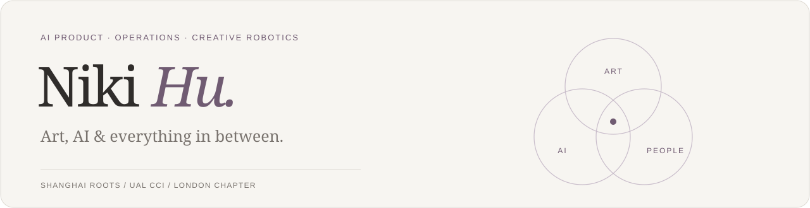
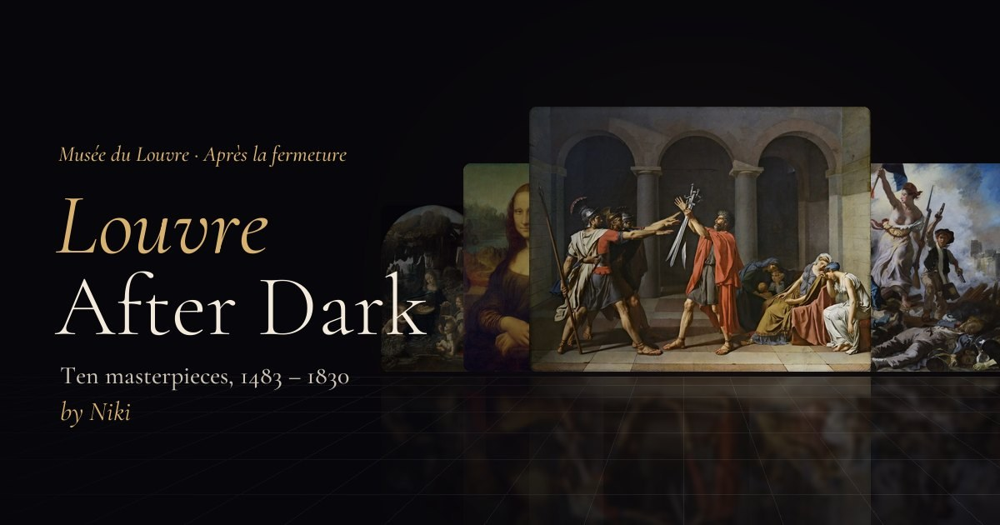
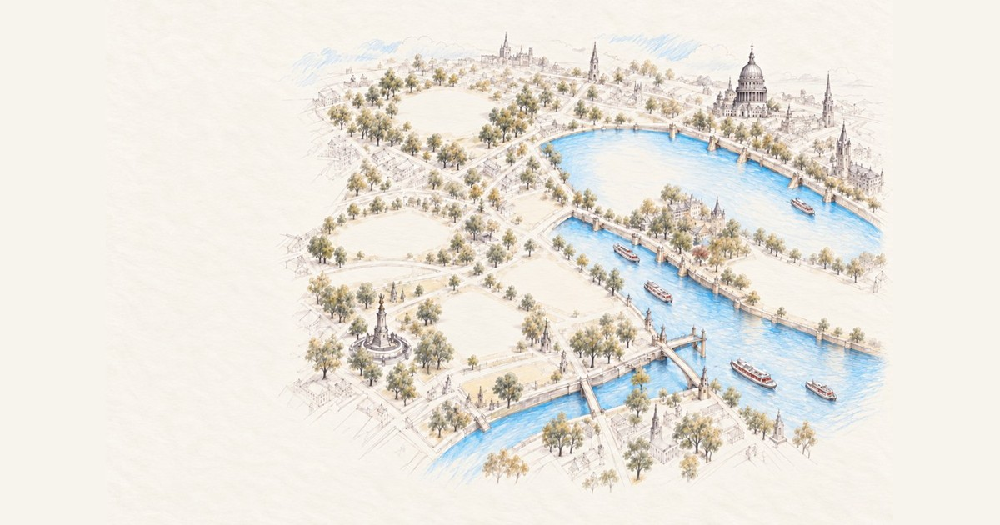

  <a href="https://nikihu-a.github.io/">Personal website · 个人网站</a> &nbsp; / &nbsp;
  <a href="https://nikihu-a.github.io/#work">Portfolio · 精选作品</a> &nbsp; / &nbsp;
  <a href="https://github.com/Nikihu-a?tab=repositories">Repositories · 项目仓库</a>

## About me / 关于我

I'm **Niki Hu**, from Shanghai, with an **MSc in Creative Robotics at UAL CCI** and experience in **AI product management and operations at [Pagepeek](https://pagepeek.ai/), London**.

I explore the connections between art, AI and people through product work, physical prototypes and AI-assisted web experiences.

来自上海，UAL CCI 创意机器人硕士背景，曾在伦敦 [Pagepeek](https://pagepeek.ai/) 从事 AI 产品经理与运营工作。我的项目连接艺术、交互、机器人和 AI 产品实践。

`AI Product` `Operations` `Creative Robotics` `Interaction Design` `Creative Coding` `AI-assisted Development`

## Skills & project tools / 技能与项目工具

| Area | Practice |
| :--- | :--- |
| **Product & operations / 产品与运营** | AI 产品与运营、用户研究、用户旅程、产品内容传播 |
| **AI product prototyping / AI 产品原型** | RAG 知识库、模型配置、AI 产品评测、Agent Skills |
| **Interaction & robotics / 交互与机器人** | 交互概念、实体原型、Arduino 传感与控制、VR 场景探索、团队机器人项目 |
| **Creative technology / 创意技术** | TouchDesigner 粒子视觉、交互投影、three.js / WebGL 网页体验 |
| **Tools used in projects / 项目使用的工具** | Python · JavaScript · HTML / CSS · Arduino · TouchDesigner · Git / GitHub Pages |
| **AI-assisted workflows / AI 协作工作流** | Agent Skills、任务拆解、浏览器验证、素材处理与静态网站发布 |

*Tools describe project experience; they are not proficiency ratings. 工具标签代表项目实践，不代表熟练度评级。*

## AI product projects / AI 产品项目

| Project | Overview | Availability |
| :--- | :--- | :--- |
| **知枢 · 企业知识库中台 / Zhishu Knowledge Platform** | 企业知识库原型，连接知识导入、RAG 检索问答、模型配置与运行日志。A knowledge-platform prototype connecting ingestion, retrieval-grounded chat, model configuration and logs. | Private source · 仅展示简介 |
| **AI 产品拆解 Skill / AI Product Teardown** | 基于证据的 AI 产品拆解工作流，覆盖场景评测与架构分析，支持飞书、Markdown 和 HTML 报告。An evidence-led analysis skill for AI product evaluation and reporting. | Private source · 仅展示简介 |

*These project summaries are public; their source repositories remain private. 项目简介公开，代码仓库保持私有。*

## Web projects & open-source tools / 网页项目与开源工具

| Project | What it explores | Links |
| :--- | :--- | :--- |
| **Louvre After Dark** | A lamp-lit 3D gallery of ten Louvre paintings, with depth, sound and interactive details. 用灯光探索十幅名画的沉浸式画廊。 | [Live](https://nikihu-a.github.io/louvre-after-dark/) · [Code](https://github.com/Nikihu-a/louvre-after-dark) |
| **London Pencil Atlas** | An illustrated map connecting six London landmarks with stories and changing light. 六座伦敦地标的铅笔风格互动地图，使用 AI 生成插画。 | [Live](https://nikihu-a.github.io/london-pencil-atlas/) · [Code](https://github.com/Nikihu-a/london-pencil-atlas) |
| **Landing Page Skill** | A reusable workflow for planning, building, checking and publishing a single-page site with AI coding agents. 从构思到上线的单页网站 Agent Skill。 | [Guide](https://nikihu-a.github.io/landing-page-skill/) · [Code](https://github.com/Nikihu-a/landing-page-skill) |
| **Personal Portfolio** | A bilingual home for my background, selected projects and interactive case studies. 中英文个人网站，展示经历、作品与过程。 | [Live](https://nikihu-a.github.io/) · [Code](https://github.com/Nikihu-a/nikihu-a.github.io) |

  
  

## Product, robotics & art archive / 产品、机器人与艺术档案

Selected cases are available on my [portfolio](https://nikihu-a.github.io/#work). The archive below also includes concepts, coursework and collaborative prototypes; each is described at the level supported by its materials.

精选案例可点击查看，其他条目为项目概览。团队项目保留合作属性；概念与原型不写成已经上线的产品。

| Project | Focus / 内容 | View |
| :--- | :--- | :--- |
| **Pagepeek — Social Content** | 面向研究、PPT、引文、知识库与 PDF 阅读场景的产品传播素材。 | [Official site](https://pagepeek.ai/) · [Case study](https://nikihu-a.github.io/#/pagepeek) |
| **Pagepeek — Events** | 线下产品展示、演讲与交流的活动记录，作为 Pagepeek 工作案例的一部分。 | [Official site](https://pagepeek.ai/) · [Case study](https://nikihu-a.github.io/#/pagepeek) |
| **Lost Crab & Little Flower** | 机器学习与 Arduino 机器人合作项目。个人工作包括前期研究、小机器人代码、项目文档，以及协作应用 Q-learning。 | [Case study](https://nikihu-a.github.io/#/lost-crab) |
| **Lumi** | 面向情感支持的毛绒机器人概念。 | Project overview |
| **Moodlight** | 探索技术与静心体验的灯光装置。 | Project overview |
| **The Mood Lamp — Littlerobot** | 以情绪疗愈为主题的发光装置探索。 | Project overview |
| **Softies Robert — Starfish** | 团队海星仿生设计探索，沿用原演示标题。 | Project overview |
| **Digital Twin** | VR 与机械臂合作项目；材料记录的个人贡献为应用场景研究与演示制作。 | Project overview |
| **Memories in the Ashes** | TouchDesigner 与 Arduino 交互投影，以距离触发粒子火焰，探索战争、和平与记忆。 | [Case study](https://nikihu-a.github.io/#/ashes) |
| **Direction** | 使用视觉识别、舵机与声音反馈的连锁机械装置原型。 | Project overview |
| **LINK** | 围绕交流和共同游玩设计的 VR 社交游乐场概念。 | [Case study](https://nikihu-a.github.io/#/link) |
| **Dream Printer** | 连接梦境记录、解释叙事与打印输出的床边设备概念。 | [Case study](https://nikihu-a.github.io/#/dream-printer) |
| **Smell Travel** | 通过城市气味与个性化嗅觉选择探索旅行体验。 | Project overview |
| **音频响应粒子实验 / Audio-reactive Particles** | TouchDesigner 音频分析、频段映射、参数控制与粒子渲染。 | [Technical case](https://nikihu-a.github.io/#/audio-particles) |
| **The Second Moon** | 围绕气候与太阳辐射调节展开的推想设计。 | Project overview |

<strong>Collaboration & credits / 合作说明</strong>

- **Lost Crab & Little Flower:** collaborative work by Chenliang Liu, Xinru Jia and Jiani Hu. Responsibilities were shared across the large robot, machine-learning system and small robot.
- **Digital Twin:** a group project. Application research and presentation are distinguished from teammates' modelling and control-system contributions.
- The London atlas uses AI-generated illustrations. Louvre paintings and other third-party materials retain the credits in their project repositories.
- Archive items without a case-study link are listed as summaries; original coursework files and private source materials are not published here.

---

**Art × AI × People** · [Explore my work](https://nikihu-a.github.io/#work)
